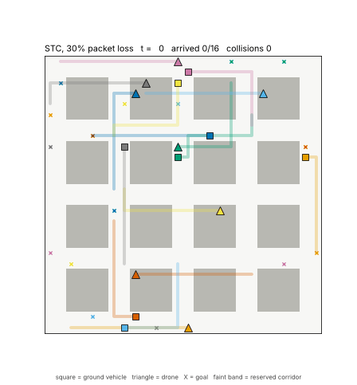
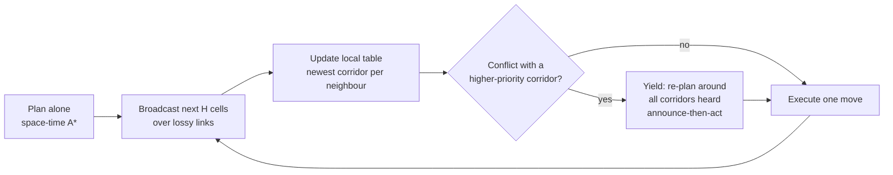
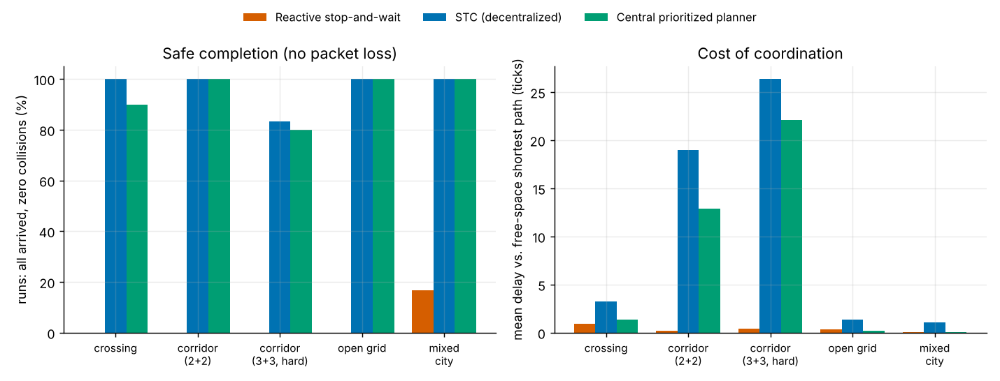
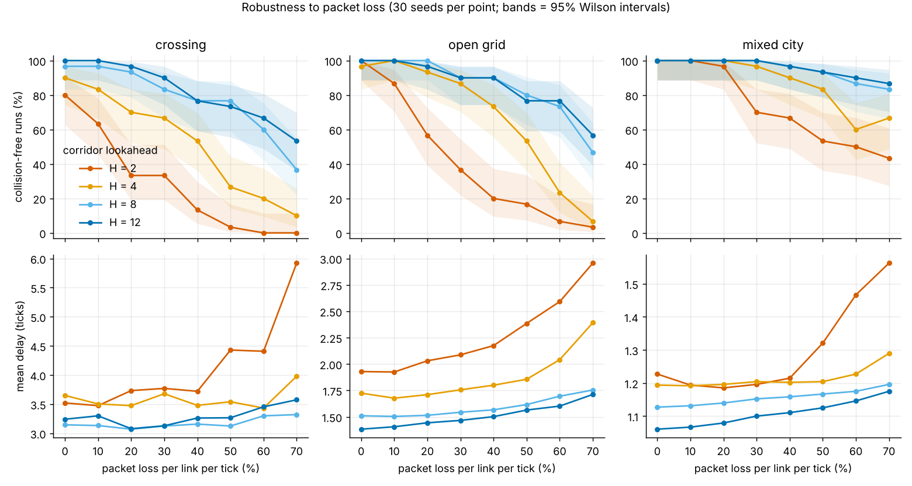
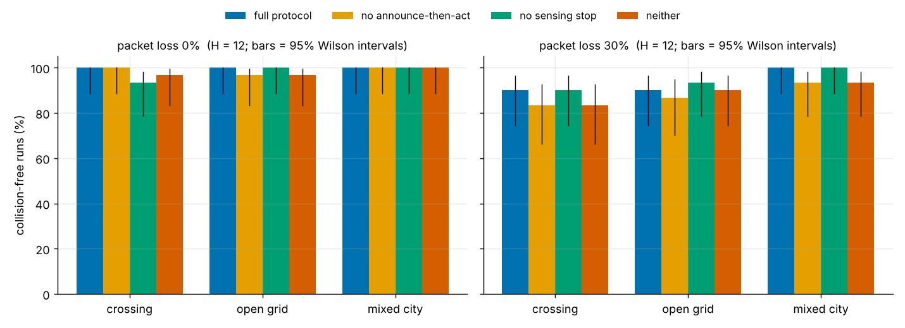

# stc-corridors


**Decentralized Spatio-Temporal Corridor (STC) negotiation for mixed ground and aerial agents, under packet loss. Pure-Python simulation: no hardware, no ROS, no GPU.**



*16 agents (8 drones descending to street-level landing pads, 8 ground vehicles) share a street grid. Every agent plans alone, broadcasts its next 12 ticks as a "corridor", and yields when it hears a higher-priority corridor. 30% of all messages are dropped. Zero collisions in this run.*

## The question

Single-vehicle autonomy is mature. Getting **many** vehicles, on the ground **and** in the air, to share space without a central server is not. A central controller is a single point of failure and a latency bottleneck; purely reactive avoidance freezes or collides in tight spots.

This project tests one concrete idea:

> Each agent reserves a short **4D corridor** `(x, y, z, t)` ahead of itself and broadcasts it. Conflicts are resolved by priority-based yielding. Because the corridor covers *H* ticks ahead, a neighbour gets *H* chances to hear about a conflict before it happens, so the protocol can tolerate message loss.

**Research question:** *how does corridor lookahead H trade safety, delay and bandwidth when the network drops packets?*

## How it works



* **World:** discrete 3D grid, one tick = one move or wait. Ground agents live on `z = 0`; drones move in 6 directions and can fly over buildings (z = 0..2) but must descend through street canyons to land.
* **Planner:** cooperative space-time A* with vertex and head-on-swap constraints; waiting is a legal action, which is how low-priority agents yield.
* **Protocol:** `Reservation(sender, priority, t_sent, t0, cells)` broadcast every tick; a per-agent table keeps the newest corridor per neighbour; the lower-priority agent of a conflicting pair re-plans.
* **Announce-then-act:** a freshly planned corridor starts with a forced wait, so neighbours see it one tick before it is used.
* **Safety layer:** adjacent-cell occupancy sensing stops an agent from stepping into an occupied cell.
* **Ground-truth checker:** every tick, an independent checker counts vertex collisions and head-on swaps, so the numbers do not depend on the agents' own beliefs.

Full details: [`docs/DESIGN.md`](docs/DESIGN.md).

## Results

All numbers come from `results/*.csv`, produced by one seeded command (see [Reproduce](#reproduce)). **30 seeds per cell**, so one run = 3.3 percentage points; treat differences smaller than ~10 points as noise (95% Wilson intervals are drawn in the figures).

### 1. Against baselines, no packet loss



| Scenario | Reactive stop-and-wait | **STC (this work)** | Central prioritized planner |
|---|---:|---:|---:|
| Crossing (8 agents) | 0% | **100%** | 90% |
| Corridor 2+2 | 0% | **100%** | 100% |
| Corridor 3+3 (hard) | 0% | **83%** | 80% |
| Open grid (16 agents) | 0% | **100%** | 100% |
| Mixed city (8 air + 8 ground) | 17% | **100%** | 100% |

*Metric: share of runs in which all agents arrive and there are zero collisions.* The reactive baseline fails because agents only see occupied cells, not intent. The central planner is a reference, not a strict upper bound: sequential prioritized planning is incomplete, so it also fails on some instances.

**The cost:** STC agents are slower than the central planner (mean delay over free-space shortest path, in ticks: open grid 1.38 vs 0.22, mixed city 1.06 vs 0.03, crossing 3.24 vs 1.34). Announce-then-act and yielding both cost time. (Reactive agents look fast in the delay chart only because they collide instead of waiting; delay is meaningful for safe runs.)

### 2. Packet loss and corridor lookahead



Collision-free runs (%), open grid / mixed city / crossing:

| Lookahead H | 30% loss | 50% loss | 70% loss |
|---|---|---|---|
| 2  | 37 / 70 / 33 | 17 / 53 / 3 | 3 / 43 / 0 |
| 4  | 87 / 97 / 67 | 53 / 83 / 27 | 7 / 67 / 10 |
| 8  | 90 / 100 / 83 | 80 / 93 / 77 | 47 / 83 / 37 |
| 12 | 90 / 100 / 90 | 77 / 93 / 73 | 57 / 87 / 53 |

**Takeaway:** going from H = 2 to H = 8 is the difference between failing and mostly working at 30% loss; beyond H ≈ 8 the returns diminish. Safety still degrades as loss rises (at 70% loss and H = 12, 57% of open-grid runs and 53% of crossing runs stay collision-free), so this is *graceful*, not *guaranteed*.

### 3. What each protocol component buys (ablation)



Announce-then-act was equal or better than the variant without it in 11 of 12 matched comparisons (e.g. mixed city at 30% loss: 93% → 100%; open grid at 0% loss: 97% → 100%), but every gap is 1-2 runs out of 30 and the intervals overlap, so this is **suggestive, not conclusive**. The adjacent-cell sensing stop shows no clear effect. More seeds are needed before either component can be credited.

## Limitations (read these first, they are the next research steps)

* **Discrete, perfect-localisation world.** No dynamics, sensor noise or continuous geometry. A real system needs MPC / control-barrier-function tracking of the reserved corridor.
* **Agents vanish at their goal.** Parking and queuing are not modelled.
* **Fixed priorities (agent index).** Low-priority agents can be starved; fairness and dynamic priority are open.
* **No deadlock resolution.** In the hard single-lane corridor (3+3) the protocol still fails on ~17% of seeds even without packet loss: agents can be squeezed between two approaching corridors.
* **Collisions under loss are possible.** The protocol degrades gracefully; it does not give a formal guarantee. Quantifying a bound (roughly, probability that *all* H broadcasts before a conflict are lost) is a planned follow-up.
* **Independent per-link loss.** Real radio loss is bursty and range-dependent.
* **Small instances (≤16 agents).** Scaling behaviour is untested.

## Reproduce

```bash
git clone https://github.com/olamida/stc-corridors && cd stc-corridors
pip install -r requirements.txt
pytest -q                                   # 14 tests
python experiments/run_benchmarks.py        # ~2-3 min on 2 cores; writes results/*.csv
python experiments/make_figures.py          # writes figures/*.png and results/summary.md
python experiments/make_demo.py 15          # writes figures/demo_mixed_city.gif
```

Quick start in Python:

```python
from stc import SCENARIOS, SimConfig, run
world, agents = SCENARIOS["mixed_city"](n_ground=8, n_air=8, seed=15)
r = run(world, agents, SimConfig(mode="stc", horizon=12, loss=0.3, seed=15))
print(r.success, r.collision_events, r.mean_delay)
```

## Repository map

```
src/stc/world.py      3D grid, ground/air kinematics, BFS heuristics
src/stc/planner.py    space-time A* with vertex + swap constraints
src/stc/protocol.py   Reservation messages, local table, conflict test
src/stc/agent.py      per-agent plan / re-plan logic (priority-aware fallbacks)
src/stc/sim.py        tick simulator: stc | reactive | central + collision checker
src/stc/scenarios.py  crossing, corridor, open_grid, mixed_city (seeded)
experiments/          benchmarks, figures, demo
tests/                14 tests (planner, protocol, end-to-end, determinism)
docs/                 DESIGN.md, PROJECT_LADDER.md, OUTREACH.md
```

## Where this is going

This is v0.1 of a longer line of work on **resource-constrained, communication-degraded multi-agent autonomy**: adding formal safety filters (Signal Temporal Logic / control barrier functions), human-aware planning, realistic communication models, and application studies in energy-infrastructure inspection. See [`docs/PROJECT_LADDER.md`](docs/PROJECT_LADDER.md).

## Related ideas worth reading next

Prioritized planning (Erdmann & Lozano-Pérez, 1987), Cooperative A* (Silver, 2005) and Conflict-Based Search (Sharon et al., 2015) from multi-agent path finding; HKUST's RACER for decentralized multi-UAV exploration. This repository does not claim to improve on any of them; it studies how a *lookahead-window* protocol behaves under lossy communication.


## Simulated animation

[](figures/demo_mixed_city.gif)

*Mixed ground/air traffic at 30% packet loss. Regenerate with `python experiments/make_demo.py 15`; the frames are produced by this project's own simulator.*


## How this connects

Formal companion: [`stc-formal`](https://github.com/olamida/stc-formal). Application study: [`pipeline-patrol-swarm`](https://github.com/olamida/pipeline-patrol-swarm). Longer plan: [`docs/PROJECT_LADDER.md`](docs/PROJECT_LADDER.md).

## Portfolio documentation

- [`APP-GUIDE.md`](APP-GUIDE.md) — work executed and work still to do.
- [`USER-GUIDE.md`](USER-GUIDE.md) — end-user manual.
- [`PENDING-TASKS.md`](PENDING-TASKS.md) — AI session-continuity ledger.
- [`SYSTEM-DOCUMENTATION.md`](SYSTEM-DOCUMENTATION.md) — developer/architecture reference.

## License

MIT. See [LICENSE](LICENSE).
